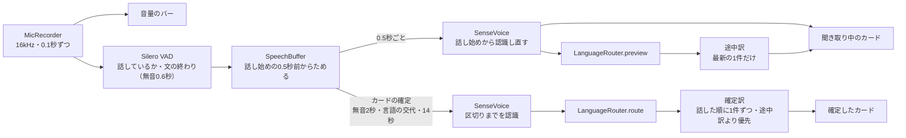

# 会話翻訳

更新日：2026-11-06

## 方針

端末を2人の間に置き、マイクを入れたまま話すと、話している最中から聞き取った文字とその訳（途中訳）が出て、話し終わるたびに確定した訳が出る。日本語と、相手の韓国語または英語を、双方向に訳す。読み上げは自動ではせず、確定したカードの訳文をタップしたときだけ読む（「読み上げ」）。

音声認識は、最初の実装として選んだSenseVoice Small＋Silero VAD（sherpa-onnx）で通した。作者は「音声入力の機敏さと、リアルタイムな訳文の展開がすごくいい。Google翻訳やPapagoより使い勝手が良い」と評価している（2026-11-06）。エンジンの比較は、使って不満が出たら行う（「音声認識の候補」）。

1回の発話の流れ（`ConversationViewModel`、`SenseVoiceAsr`）：

1. マイクの音声を0.1秒ずつ受け取り、音量をバーに出す（`MicRecorder`）。
2. VADが話し始めを検出したら、音声をため始め、聞き取り中のカードを出す（`SpeechBuffer`）。
3. 話している間は、0.5秒ごとに話し始めからの音声を認識し直し、途中の文字を出す。その文字を訳して途中訳も出す（「途中結果と途中訳」）。
4. 無音が2秒続くか、話し手が代わる（言語が変わる）か、14秒話し続けたら、カードを確定させる（「カードの区切り方」）。
5. 確定した文の訳す方向を決め（`LanguageRouter`）、確定訳を出す。確定訳は途中訳より先に訳す。



## 操作

| 操作 | 動き |
| --- | --- |
| 開く | トップ画面のいちばん大きな「会話翻訳」のタイル、またはアイコンの長押しメニューの「会話翻訳」。初めは録音の許可を求める |
| 開始・停止 | 開始で聞き始める。停止すると、話しかけだった分も確定させて訳す |
| 表示 | 「対面」と「1画面」を切り替える。選んだ方は次に開いたときも使う（「画面」） |
| 自分 ▾ | 日本語（既定）・韓国語・英語・中国語（簡体字）・中国語（繁体字・広東語）。選んだ方は次に開いたときも使う（2026-11-08、作者の要望）。相手を同じ言語に固定していたら、相手は自動に戻る |
| 相手 ▾ | 自動・日本語・韓国語・英語・中国語（簡体字）・中国語（繁体字・広東語）から、自分と同じ言語を除いたもの。自動は相手が話した言語を覚えて、自分の発話をその言語へ訳す（「訳す方向」）。2026-11-08に中国語を足して5つになったので、チップからメニューにした |
| ログ ▾ | 共有（ほかのアプリへ送る）・ファイルに保存・画面の発話を消去（「会話ログ」） |
| 翻訳モデル（操作欄の右「2B・GPU ⚙」） | 今のモデルと状態を出し、押すと0.8B／2Bを切り替える（`ModelSwitch`、2026-11-06。`docs/03_翻訳コア.md`「翻訳モデルの大きさ」） |
| 画面を離れる | マイクを止める（フォアグラウンドサービスはまだ無い） |

会話中は画面を点けたままにする（`FLAG_KEEP_SCREEN_ON`）。

## 音声の取り込み

| 項目 | 内容 |
| --- | --- |
| 権限 | `RECORD_AUDIO` だけ。画面を開いている間だけ聞くので、サービスと通知は使わない |
| 録音 | `AudioRecord`、音源は `VOICE_RECOGNITION`（端末の音量調整・雑音処理を音声認識向けにしたもの）、16kHz・モノラル・PCM16。floatに直して0.1秒ずつ流す（`MicRecorder`） |
| 音量 | 0.1秒ごとの二乗平均を、-55dBFS（静かな部屋）〜-15dBFS（近くで話す）で0〜1に割り当ててバーに出す。話していると判定している間はバーの色を変える |
| スレッド | 録音は `Dispatchers.IO`、音声認識は専用スレッド `PlamoAsr` で1本ずつ順に呼ぶ |

## 音声認識

### 使うエンジン

sherpa-onnx 2.0.1（ONNX Runtimeを内部に静的に組み込んだAAR。漫画用OCRのONNX Runtimeとライブラリ名がぶつからない）で、次の2つを動かす（`core-asr` の `SenseVoiceAsr`）。

| モデル | 役割 | 設定 |
| --- | --- | --- |
| Silero VAD | 話しているかの判定と、文の終わり（無音0.6秒）の合図 | 閾値0.5、最短の発話0.25秒。最長は600秒で、VADには長い発話を区切らせない |
| SenseVoice Small int8（2024-07-17版） | 音声を文字にし、言語（日・韓・英・中・広東語）を判定する | `language=auto`、句読点と数字の書き言葉化あり、CPU 4スレッド |

SenseVoiceは2025-09-09版も公開されているが、広東語向けに追加学習した派生（WSYue-ASR）から変換したものなので使わない。モデルは初回起動時の「モデルの準備」で `files/models/asr/` にダウンロードする（開発中にadbで置く手順は `docs/06_開発環境.md`）。

`AsrEngine` は、音声を渡すたびに出来事（`AsrEvent`）の一覧を返す。

| 出来事 | 意味 |
| --- | --- |
| `Speaking(true/false)` | 話し始めた・カードが確定して話し終わった |
| `Partial` | 途中の文字。同じカードの間は、届くたびに前の途中の文字を置き換える |
| `Final` | 確定したカード（文字・言語・始まりの時刻・長さ・認識にかかった時間） |

VADは「話しているか」と「文の終わり」の合図にだけ使い、認識する音声は `SpeechBuffer` にためた分から取る。途中の文字と確定の文字が同じ音声から作られ、カードを区切っても音声が途切れない。

### 途中結果と途中訳

SenseVoiceは発話をまとめて認識する方式なので、話している間は0.5秒ごとに、話し始めからの音声全体を認識し直して途中の文字を出す（疑似ストリーミング）。

- VADは話し始めを少し遅れて検出するので、直前の0.5秒の音声を常に残しておき、ためる音声の頭に足す。
- 認識し直す間隔は、1回の認識にかかった時間の3倍より短くしない。発話が長くなってもCPUを使い切らないためである。
- 文字が前と同じなら出さない。話し終わってからカードが確定するまでの2秒の無音の間に、同じ文を訳し直さないためである。
- 日本語と中国語の結果は、SenseVoiceが語の間に入れる空白（「うち の 中学 は」）を取り除く。英数字どうしの間の空白は残す。韓国語は語の間の空白が正しい場合もあるので触らない。
- 雑音や息をSenseVoiceが聞き違えた結果を取り除く（`SenseVoiceAsr.dropFillers`）。句読点だけ（「.」）や、あいづち・つなぎの語だけ（「Yeah.」「I.」「嗯」など）の結果は、何も話していないものとして扱い、途中の文字にもカードにも出さず、言語の判定にも使わない。日本語・韓国語・中国語の文の頭と末尾に付いた英語のあいづちも取り除く。「Yes」「OK」「No」は相手の本当の返事として多いので残す。

途中訳は `ConversationViewModel` が受け持つ。

- 途中の文字が届くたびに訳す依頼を出す。依頼は最新の1件だけを持つ（`Channel.CONFLATED`）。訳している間に届いた古い依頼は上書きされて消え、訳し終わってから最新のものを訳す。走っている途中訳を取り消さないのは、0.5秒ごとに取り消すと長い文で訳が1つも出なくなるためである。
- 確定訳を優先する。カードが確定したら走っている途中訳を取り消し、確定訳が残っている間は途中訳を始めない。
- 訳し終わったとき、別のカードに移っていれば捨てる（カードの区切りごとに進める世代番号で見分ける）。
- 新しい途中の文字を訳し終わるまで前の途中訳を出しておき、ちらつかせない。生成は160トークンまで。

### カードの区切り方

区切りは「文」と「カード」の2段にした（`SenseVoiceAsr.accept`）。言いよどみや息継ぎで同じ人の話が切れないことと、話し手が代わったらすぐ別のカードになることを両立するためである（経緯は「判断の記録」）。

| 区切り | 決め方 |
| --- | --- |
| 文 | VADが0.6秒の無音で区切る |
| カード（話し終わり） | 文が終わってから、無音が合わせて2秒続いた。最後の文の終わりまでを確定させる |
| カード（話し手の交代・間あり） | 次の文が1秒たまったところで言語を判定し、前の文と違えば、前の文の終わりで区切る |
| カード（話し手の交代・間なし） | 0.5秒ごとに直近1.5秒の言語を判定し、2回続けてカードの言語と違えば区切る。区切る位置は、0.25秒ずつずらしながら1秒ずつ言語を判定して継ぎ目を探し、その前後の一番静かな0.1秒 |
| カード（長い発話） | 14秒たまったら、直近4秒のうち一番静かな0.1秒（息継ぎや語の切れ目）で区切る |

- どの区切りでも、音声の受け付けは止めない。区切った後ろの音声は、次のカードの頭に残す。
- 言語の比較では、相手が中国語でなければ、中国語・広東語の判定を日本語と同じに扱う。漢字の多い日本語が中国語と判定されることがあるためである。相手を中国語にしたとき（`AsrEngine.separateChinese`）だけ、中国語と広東語を1つの言語として日本語と分ける。
- 言語の判定が1回違っただけでは区切らない。外来語や固有名詞で一瞬揺れるためである。
- カードの言語は、カードの最初の2秒で決める。
- 中身のない文（雑音の聞き違い）は言語を持たないので、話し手の交代の判定に使わない。前の文の言語を引き継ぎ、雑音の後の本当の交代は見分ける。

## 訳す方向

`LanguageRouter` がカードごとに方向を決める。

1. SenseVoiceの言語タグを使う。判定なしは、文字の種類で決め直す（ハングル→韓国語、英字が多い→英語、それ以外→日本語）。中国語・広東語の判定は、自分か相手が中国語なら中国語（`zh`→簡体字、`yue`→繁体字）とし、仮名を含めば日本語の聞き違いとする。どちらも中国語でなければ、判定なしと同じく文字の種類で決め直す。
2. 聞き取った言語が自分の言語なら自分の発話、そうでなければ相手の発話とする。中国語の簡体字と繁体字（広東語）は同じ話し手の言語とみなす。方向は次の規則で決める（自分の言語は2026-11-08から選べる。既定は日本語）。

| 相手の設定 | 自分の発話 | 相手の発話 |
| --- | --- | --- |
| 自動 | 直前に覚えた相手の言語へ訳す（初期値は日本語・韓国語・英語のうち自分以外の先頭。日本語の自分なら韓国語） | 自分の言語へ訳し、その言語を相手の言語として覚える |
| 日本語・韓国語・英語（固定） | 固定した言語へ訳す | 自分の言語へ訳す。判定が固定と違っても固定した言語として扱う |
| 中国語（簡体字・繁体字）（固定） | 固定した字体の中国語へ訳す | 自分の言語へ訳す。原文の言語は聞き取った判定に従う（標準中国語→簡体字、広東語→繁体字）。ほかの言語と判定されたら固定した中国語として扱う |

自分が中国語のときは、自分の発話の原文の字体も聞き取った判定に従う（標準中国語→簡体字、広東語→繁体字）。

PLaMo 3 Translateに広東語は無いので、広東語の発話は繁体字の中国語として訳し、自分の発話も書き言葉の中国語（繁体字）で返す（2026-11-08）。広東語の口語の字（「嘅」「咗」など）を含む原文の訳の質は、実機で確かめていない。

途中訳は、その時点の判定で方向を決めるが、相手の言語としては覚えない（`LanguageRouter.preview`）。途中では判定が揺れやすいためである。確定したときに方向が変われば、確定訳で置き換わる。

## 翻訳

- 確定したカードを、話した順に1件ずつ訳す。翻訳モデルは画面翻訳と同じ `EngineHolder` のもの（`docs/03_翻訳コア.md`）。0.8Bと2Bを選べ、作者は2Bで使っている。2Bは約2.5倍遅いので、途中訳（0.5秒ごと）が追いつくかを作者が話して確かめ、既定のモデルを決める（`docs/00_現在地.md`「次の作業」）。下の「評価」の数値は0.8Bで測ったもの。
- 日本語への訳は `form = polite`。
- 訳す文は1つのカードの文だけで、直近の会話は文脈として渡していない（「残る問題」）。

## 画面

### 対面と1画面

| 表示 | 並べ方 |
| --- | --- |
| 対面 | 上下2分割。上半分は相手向けに逆さに出し、下半分は自分向け。各カードは、読む人の言語で書かれた方を上に大きく、もう一方をその下に出す。自分は自分の言語、相手は相手の言語を読む |
| 1画面 | 2人で1つの一覧を見る。自分の発話を右、相手の発話を左に置き、原文の下に訳を大きく出す（Google翻訳の会話モードにある2つの見せ方を、作者の要望で両方用意した） |

対面の相手向けの半分は、一覧ごと180°回さず、各カードだけを回して並びを下から上（`reverseLayout`）にした。一覧ごと回すと、スクロールで指を離したときの勢い（フリング）の向きがずれて急に止まったためである。新しい発話が来たら末尾へ送るが、読み返そうと末尾から離れている間は動かさない。

### カードのデザイン

2人が注視して読むものとして作った（`ConversationActivity`）。

- **文字**：読む人の言語の文（対面）・訳文（1画面）は26sp、もう一方（原文を含む）は20sp。かかった時間だけ小さい文字にする。原文を大きくするのは、話した人が「自分の言葉がどう聞き取られたか」を確かめる大事な情報だからである。
- **見出し**：カードの上に「自分・日本語 → 韓国語」のように、誰が何語から何語へ話したかを出す。相手向けの面は、相手が日本語を読めないので「JA → KO」と言語の略号にする。
- **色**：話した人ごとに分ける（自分は `primaryContainer`、相手は `tertiaryContainer`）。対面の上下どちらでも、同じ人の発話は同じ色になる。背景は両面とも同じ地の色にし、カードと混ざらないようにする。
- **訳し中**：確定したカードの訳がまだ届いていない間は、訳の文を薄い色で出す。
- **話し中のカード**：枠線（`primary`、2dp）で囲み、「● 話し中」（相手向けは「● LIVE」）の見出しを付ける。文字は確定したカードと同じ大きさ・濃さで、まだ変わることは見出しと枠で示す。
- **操作欄**：地の色と分けた帯にし、上下の線で会話の一覧と区切る。対面では2人の面の境目になる。

## 会話ログ

操作欄の「ログ」から、画面に出ている発話を書き出す。後から振り返ったり、別のアプリで議事録にしたりするためである。

| 操作 | 動き |
| --- | --- |
| 共有 | Androidの共有画面で、テキストとしてほかのアプリ（メモ、メール、議事録を作るアプリなど）へ送る |
| ファイルに保存 | 保存先を選んでもらい（Storage Access Framework）、Markdownのファイル（`会話ログ_YYYY-MM-DD_HHmm.md`）として書く |
| 画面の発話を消去 | 新しい会話を始めるときに使う |

書式は `ConversationLog` が作る。見出しに日付と時間帯、言語と発話数を置き、発話ごとに時刻・話した人（自分・相手）と言語・原文・訳を並べる。議事録を作るアプリやAIへそのまま渡しても、誰が何を言ったかが読み取れる形にした。

```markdown
# 会話ログ 2026-11-06 14:03〜14:10

- 言語：日本語 ⇄ 韓国語
- 発話：3件
- PLaMo翻訳の端末内の音声認識と翻訳による。聞き違い・訳し違いを含むことがある

**14:03:05 相手（韓国語）**
原文：안녕하세요
訳（日本語）：こんにちは
```

ログはアプリの中には残さない。画面を閉じると発話は消えるので、残したい会話はその場で共有か保存をする。

## テキスト翻訳の音声入力

2026-11-08、作者の要望で、テキスト翻訳の原文を音声でも入れられるようにした（`TranslateViewModel.startVoice`）。会話翻訳と同じSenseVoiceとマイク（`MicRecorder`）を使い、モデルは初めてマイクを押したときに読み込む。

- 原文の欄の右端のマイクを押すと、1つの発話を聞き取る。話している間は途中の文字を欄に出し、話し終わる（2秒黙る）と止まって訳す。■を押すと、話しかけの分も確定させて止める。話し始めずに8秒たつと止まる。
- すでに書いてある原文の後ろに足す。日本語・中国語どうしは詰め、韓国語・英語は空白を挟む（`joinSpoken`）。
- 聞き取れるのは日本語・韓国語・英語・中国語・広東語だけ。原文の言語を中国語にしているときは、中国語を日本語と別の話し手として区切る。

## 読み上げ

2026-11-08、作者の要望で、訳文を読み上げられるようにした（`ReadAloud`、`core-tts`）。自動では読まない。

- **会話翻訳**：確定したカードの訳文をタップすると、訳した先の言語で読む。対面では、相手の面の訳文をタップすれば相手の言語で読む。読んでいる間はカードの見出しに🔊が出て、もう一度タップすると止める。別のカードを押すと、前のものを止めて読み直す。
- **テキスト翻訳**：訳文の右端の中央の🔊で読む（原文の欄の右端のマイクと対になる位置）。
- **マイクとの関係**：会話翻訳はマイクを入れたまま使うので、読んでいる間と読み終わってから0.4秒は、マイクの音を無音に置き換えて音声認識へ渡す（`ConversationViewModel.feed`）。読み上げの声を相手の発話として拾わないため。無音を渡すので、話しかけの発話はそこで区切られる。
- **読むもの**：設定の画面の「読み上げ」で選ぶ。既定はSupertonic 3（約220MBを設定の画面からダウンロード）。ダウンロード前と、Supertonic 3が読めない言語（中国語）は、Androidの読み上げエンジンで読む。声（voice.binの声の番号）、速さ（×0.8〜×1.4）、音質（音を作る段数3〜16、既定8のスライダー）を選べ、日本語・韓国語・英語の例文で試せる。
- **Supertonic 3の動かし方**：sherpa-onnxの `OfflineTts`（4スレッド、音を作る段数は設定で3〜16・既定8、言語は `extra["lang"]`）。重みはsherpa-onnx向けのint8版（`csukuangfj2/sherpa-onnx-supertonic-3-tts-int8-2026-05-11`）で、vocoderだけ公式のfp32版（`Supertone/supertonic-3` の `onnx/vocoder.onnx`）にする。int8版のonnxは公式版をそのまま量子化したもの（量子化していない `duration_predictor`・`text_encoder` は公式版とハッシュが一致）なので、差し替えて動く。モデルは初めて読むときに読み込み（0.8〜0.9秒）、アプリを閉じるまで持つ。sherpa-onnxは渡した文をまとめて作り終えてから音を1回で返すので、訳文を文（。！？!? と、空白の前の . と改行）に分け、1文ずつ作って `AudioTrack` で鳴らす。鳴らしている間に次の文を作る。鳴らす側は約46ミリ秒ずつ書き、区切りごとに止めるかを見る。1文をまとめて書くと書き終わるまで戻らず、止めても・別のものを読んでも・画面を離れても鳴り続け、次の読み上げと重なった（2026-11-08、作者の指摘）。最初の音までの時間はログ（`読み上げ: 最初の音まで`）に出す。
- **コールバックはクラスで渡す**：sherpa-onnxのネイティブ側は、コールバックの `invoke(float[]): Integer` を名前と型で探して呼ぶ。Kotlinのラムダで渡すとinvokedynamicで作られてこのメソッドが無く、`NoSuchMethodError` でアプリが落ちた（0.4.0の最初のビルド、2026-11-08に実機で見つけた）。`object : (FloatArray) -> Int` で渡す。

### 読み上げの速さ（2026-11-08、REDMAGIC 11 Pro）

日本語の例文（4.2秒分の音）を作る時間。スレッド数ごとにモデルを読み直し、各2回の平均。

| スレッド \ 段数 | 3 | 5 | 8 |
| --- | --- | --- | --- |
| 2 | — | 1.69秒 | 2.59秒 |
| 4 | 0.96秒 | 1.53秒 | 2.36秒 |
| 6 | 0.95秒 | 1.49秒 | 2.33秒 |

10秒分の文では、4スレッドで3段2.2秒・5段3.4秒・8段5.4秒。作る時間は音の長さと段数にほぼ比例し、スレッドは4を超えても速くならない。

- **最初の判断**：段数は待ち時間と質の間をとって5、スレッドは4にした。文に分けたことと合わせて、例文（2文）の最初の音までは2.3〜2.9秒（8段、2スレッド、全文をまとめて作る）から0.5〜0.7秒になった。

### 音質（2026-11-08、REDMAGIC 11 Pro）

作者が段数5で聞き、話している最中にザラつきがあると言った（無音の部分ではない）。音割れは無かった（最大振幅0.30〜0.38）。int8で量子化されているのは `vector_estimator`（257MB→78MB）と `vocoder`（101MB→26MB）の2つなので、公式のfp32版と差し替えて比べた。

ザラつきの目安に、話している区間（音の大きい上位40%）の1〜8kHzのスペクトルの平坦さを使った。倍音の間がノイズで埋まるほど大きくなる。日本語の10秒の文（韓国語の4.5秒の文も同じ傾向）：

| 重み \ 段数 | 5 | 8 | 12 | 16 |
| --- | --- | --- | --- | --- |
| 全部int8 | 0.039 | 0.037 | 0.035 | 0.032 |
| vocoderだけfp32 | 0.030 | 0.025 | 0.025 | 0.021 |
| 両方fp32 | 0.026 | 0.022 | 0.021 | 0.019 |

作る時間（10秒分の日本語、4スレッド）：

| 重み \ 段数 | 5 | 8 | 12 | 16 |
| --- | --- | --- | --- | --- |
| 全部int8 | 3.5秒 | 5.3秒 | 7.9秒 | 10.3秒 |
| vocoderだけfp32 | 3.6秒 | 6.1秒 | 9.5秒 | 9.9秒 |
| 両方fp32 | 4.6秒 | 6.9秒 | 10.2秒 | 13.1秒 |

- **判断**：ザラつきの主な原因はint8のvocoderで、int8のままでは段数16でもfp32のvocoderの段数5に届かない。vocoderだけfp32にすると改善の大半が得られ、遅くなるのは1〜2割、ダウンロードは約101MB増える（合計約220MB）。`vector_estimator` もfp32にすると、さらに約178MB増えて2〜3割遅くなるわりに差が小さいので、int8のままにした。
- **段数**：増やすほどザラつきが減り、作る時間はほぼ比例して延びる。作者の希望でスライダー（3〜16）にし、既定は8にした。8で例文の最初の音までは約1.1秒。スレッドは4を超えても速くならないので、設定には出さない。

## 評価

### 動作確認の方法

デバッグ版は、adbから音声ファイル（16kHz・モノラル・16bitのWAV）を渡すと、マイクの代わりに実際の話す速さ（0.1秒ずつ）で流して認識・翻訳し、結果をlogcatに出す。音声認識と翻訳モデルの両方の準備が済んでから流れ始め、末尾にはカードの区切り（無音2秒）より長い3秒の無音を足す。

```powershell
adb shell setprop log.tag.PlamoTranslate V
adb push ja.wav /sdcard/Android/data/app.plamotranslate/files/asr-test/
adb shell am start -S -n app.plamotranslate/.conversation.ConversationActivity --es wav /sdcard/Android/data/app.plamotranslate/files/asr-test/ja.wav
adb logcat -s PlamoTranslate:I   # 「会話: 途中 …」「会話: 途中訳 …」「会話: 認識 …」「会話: 翻訳 …」
```

試験音声はSenseVoiceのモデルに付属する `test_wavs/`（日・韓・英など）を使う。確かめ終わったら `asr-test/` は端末から消す。

### 結果（2026-11-06、REDMAGIC 11 Pro）

1発話ずつ流した結果：

| 音声 | 認識 | 確定訳 | 時間 |
| --- | --- | --- | --- |
| 日本語 5.8秒 | うちの中学は弁当制で持っていけない場合は、50円の学校販売のパンを買う。 | 우리 중학교는 도시락제라 가져갈 수 없을 때는 학교에서 판매하는 50엔짜리 빵을 산다. | 認識0.2秒・翻訳0.8〜0.9秒 |
| 韓国語 2.9秒 | 금만 생각 을 하 면서 살 면 훨씬 편할 거야. | お金のことばかり考えて生活したほうがずっと楽ですよ。 | 認識0.06〜0.1秒・翻訳0.2〜0.3秒 |
| 英語 5.5秒 | The tribal chieftain called for the boy and presented him with 50 pieces of code. | 部族の首長は少年を呼び寄せ、暗号を50枚渡しました。 | 認識0.2秒・翻訳0.3〜0.4秒 |

- **途中の文字**：0.5秒ごとに出る。日本語では「うちの中学。」→「うちの中学は弁当制で。」→…と伸びた。
- **途中訳**：途中の文字の0.1〜0.9秒後に付く（文が長いほど時間がかかる）。英語では「トリ。」→「部族の長は彼らを。」→…と更新され、話し終わる前に確定訳と同じ文になった。途中訳を足しても、確定訳の翻訳時間は変わらなかった。
- **確定まで**：話し終わってから確定訳が出るまで約2.5〜3秒（無音を待つ2秒を含む）。その間も途中訳は出ている。最初の版（無音0.5秒で区切る）では約1〜1.3秒だった。

話し手の交代：日・韓・英・日を間を空けずにつないだ26秒の音声は、4枚のカードに分かれ、日→韓、韓→日、英→日、日→英（自動で、直前の相手の英語を覚えた）と訳された。区切りの前後で文が欠けることはなかったが、韓国語の頭の語は「만 생각…」と欠けた。この韓国語の音声は、単独で流しても頭の「조」が抜けて「금만…」と読まれる。

作者が実機で話して確かめ、「すごくいい。一旦これでいい」と言った（2026-11-06、話し手の交代での区切りとカードのデザインを入れた版）。

## 判断の記録

| 日付 | 判断 | 理由・根拠 |
| --- | --- | --- |
| 2026-11-06 | 音声認識はsherpa-onnxのSenseVoice Small＋Silero VADで始める（作者了解「入れてよい」） | 当初の計画どおり、確実に動く1エンジンで通す。sherpa-onnxはONNX Runtimeを静的に組み込んだAARを使い、漫画用OCRのONNX Runtimeとぶつけない |
| 2026-11-06 | SenseVoiceは2024-07-17版を使う | 2025-09-09版は広東語向けに追加学習した派生（WSYue-ASR）からの変換で、日本語・韓国語の会話に向かない |
| 2026-11-06 | `AsrEngine` は、音声を渡すと出来事の一覧を返す同期の形にする | 当初は `Flow` で出来事を流す形を考えていた。呼び出し側が専用スレッドで音声を渡すので、`Flow` を挟まない方が単純 |
| 2026-11-06 | 途中訳より先に、音量のバーと途中の文字を出す | 最小版を使った作者の感想「結構悪くない。音声入力の正確さは結構いい」「ライブの音声入力の状況が見えるのが一番の優先」 |
| 2026-11-06 | 対面の相手向けの面は、一覧ごとでなくカードごとに回す | 作者の指摘「スワイプして手を離した瞬間にすごいブレーキがかかる」。一覧ごと回すとフリングの向きがずれた |
| 2026-11-06 | 「対面」と「1画面」を切り替えられるようにする | 作者の要望。Google翻訳の会話モードにある、一画面を2人で見る見せ方も欲しい |
| 2026-11-06 | 会話ログは共有とMarkdownでの保存にし、アプリ内には残さない | 作者の要望「後から振り返ったり、別のアプリで議事録にしたい」。履歴を見返す画面は使ってから決める |
| 2026-11-06 | 途中訳を足す（イテレーション5） | 作者の要望「ライブ入力中の文字はネイティブの文字しかないので、訳文も同時に」。翻訳は1回0.2〜0.7秒で、途中の文字の間隔（0.5秒）に近い |
| 2026-11-06 | 話し終わりを無音0.5秒から2秒にする | 作者の要望「ライブで翻訳が見えるようになったから、発話の終わりは2秒くらい待ってほしい」 |
| 2026-11-06 | 長い発話はVADの最長で区切らず、自分で静かなところを探して区切る | 作者の指摘「15秒の区切りで、次のカードの話し始めが気持ち悪い」。VADの最長で区切ると、次の話し始めを検出し直す間の音声が抜けていた |
| 2026-11-06 | カードを話し手の交代（言語の変化）でも区切る。話している最中も言語を見張る | 2秒に延ばしたあと、話し手が2秒以内に代わると2つの言語が1枚にまとまり、片方がほとんど読めなくなった。作者の指摘「高速で話し合うときに致命的。2秒置いてどうぞとするのは会話のキャッチボールとして良くない」「音声入力の受付は続けたまま、カードを区切って訳す向きを切り替えて」 |
| 2026-11-06 | 区切る位置は、静かさだけでなく言語で継ぎ目を探す | 静かさだけで探すと、継ぎ目に間が無いとき、新しい言語の文の中の小さな間を選び、新しい言語の最初の語が前のカードに入って消えた |
| 2026-11-06 | カードの文字を大きくし（原文20sp・訳26sp）、見出しと話した人ごとの色を付け、話し中のカードを枠で囲む | 作者の指摘「話し中は2人で注視して読むのに、動いていることを見せるだけの表示」「原文が小さすぎて、自分の言葉がどう認識されたか分からないのは致命的」「相手側のカードの色が背景と混ざって気持ち悪い」 |
| 2026-11-06 | 雑音の聞き違い（「.」「Yeah.」「I.」など）を、何も話していないものとして扱う | 作者の指摘「Yeah. とか . とかの幻覚的な音声文で翻訳が切られるのが不快。一番大事」。こうした結果は、それだけでカードになるうえ、英語と判定されて日本語の文の間に挟まると話し手の交代とみなされ、カードが途中で切れていた。英語で「Yeah」とだけ言ったカードも消えるが、会話の中身を運ばないので、誤って切られる害を重く見た |

## 音声認識の候補

SenseVoiceに不満が出たら、次の候補を実機と作者の録音で比べる。日韓の音声を端末内で認識するモデルには、どの条件でも最良と言える定番がまだなく、公開ベンチマークは条件がそろっていない。

| 候補 | 方式 | 長所 | 確かめること |
| --- | --- | --- | --- |
| Nemotron 3.5 ASR Streaming 0.6B（NVIDIA、2026-06公開） | ネイティブのストリーミング（transducer）。遅延を80〜1120msの5段階から選べる。言語の自動判定あり | 話している最中から文字が出る。疑似ストリーミングの認識し直しが要らない | 多言語版をsherpa-onnxのストリーミング認識で動かせるか。スマホCPUで日韓英をリアルタイムに処理できるか |
| Qwen3-ASR-0.6B | 発話単位の一括認識 | sherpa-onnxが公式に対応し、Androidで動く（int8、2026-03-25版） | 途中結果のための認識し直しの負荷 |
| SenseVoice Small（今使っている） | 発話単位の一括認識。言語タグを出力する | 軽く速い（5秒の発話を0.1〜0.2秒で認識）。ある韓国語ベンチマークで平均CER 12.72%（Qwen3-ASR-0.6Bは17.29%） | 作者の声・雑音のある場所での精度 |

Nemotron 3.5のONNX版は、INT4に量子化してチャンク長ごとのエンコーダーを分けた有志の書き出し（`jeffpeng3/nemotron-3.5-asr-multi-encoder-int4`）と、onnx-communityの書き出しがある。前者はsherpa-onnxの書き出しスクリプトを元にしている。sherpa-onnxで動いた公開例は英語用の構成なので、多言語での動作は比較に着手するときに最初に確かめる。ストリーミング型に替えるときは、`AsrEngine` の実装を差し替え、`Partial` をデコードのたびに出す。

比べるときの計測方法：

1. 作者が日本語・韓国語・英語で各20発話（会話調、雑音のある場所を含む）を端末のマイクで録音し、正解の書き起こしを付けて `tools/testdata/asr/` に置く（作者の声なのでGitに入れない）。
2. 動作確認の方法で各エンジンに同じ音声を流し、CER（日本語・韓国語）・WER（英語）、話し始めから最初の途中結果までの時間、話し終わりから確定までの時間、実時間係数（RTF）、言語判定の正解率を記録する。
3. 結果を表にして `docs/08_リスクと未決事項.md` に書き、作者と採否を決める。

## 残る問題

- 新しいカードの頭の語が欠けることがある。試験音声では韓国語の頭の「조금」が欠けた。実際の声で起きるかを見る。
- 韓国語の認識結果に、語の途中の余分な空白が入る（「생각 을 하 면서」）。訳への影響は小さい。
- 翻訳に直近の会話を文脈として渡していない。代名詞や省略の多い会話で訳が不自然になりうる。`TranslationRequest` に文脈と同じ方向の直近の訳を足す（`docs/03_翻訳コア.md`）。
- 画面を離れるとマイクが止まる。画面を消しても聞き続けるには、フォアグラウンドサービス（`foregroundServiceType="microphone"`、`FOREGROUND_SERVICE_MICROPHONE`、通知）を足す。
- 会話の履歴をアプリ内で見返す画面は無い（ログの共有・保存で代える）。
- 長時間の会話での発熱と速度の低下は測っていない（`docs/08_リスクと未決事項.md`）。
